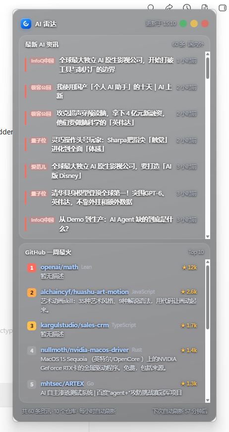

# AI 雷达 · Windows 桌面小组件


一个贴在桌面右侧的小卡片：**上半区滚动国内外最新 AI 资讯，下半区常驻 GitHub 一周最火项目 Top 10**。
透明深色面板、可拖动、不占任务栏，双击 `run.bat` 即可运行。



<details>
<summary><b>English</b>（English intro / 英文简介）</summary>

A transparent desktop widget for Windows 10/11, built with Python + pywebview.

- **Top half**: latest AI news from 10 RSS/Atom feeds (Chinese + English sources), auto-refreshes every hour, click an item to expand and read the full text. English headlines are auto-translated to Chinese, with the original kept for comparison.
- **Bottom half**: GitHub's top 10 trending repos of the week (total stars, stars gained this week, description translated to Chinese). Click to open in your browser.
- Lives in the system tray (no taskbar icon), draggable anywhere, not always-on-top by default.

Quick start: `git clone` → double-click `run.bat` (it creates its own venv and installs deps).

</details>

---

## 托盘行为

- **启动后窗口短暂显示即自动收起到系统托盘**（右下角雷达图标），并弹出一次气泡提示
- **双击托盘图标**：显示 / 隐藏窗口
- **右键托盘图标**：显示窗口 / 窗口置顶（可勾选，默认不置顶）/ 退出
- 任务栏和 Alt-Tab 里都看不到它；**退出只能通过托盘右键菜单**，点窗口上的 ✕ 只是收起

---

## 界面结构

```
┌──────────────────────────────────┐
│ ● AI 雷达          11:30  ⟳ ─ ✕  │  ← 顶部：拖动区 / 刷新 / 最小化 / 关闭
├──────────────────────────────────┤
│ 最新 AI 资讯          60 条 · 国内外 │
│ ├ 量子位   某某大模型发布…      3分钟前 │  ← 独立滚动区
│ ├ OpenAI   Introducing…        1小时前 │     点击展开看正文
│ └ The Verge  Anthropic…        2小时前 │
├──────────────────────────────────┤
│ GitHub 一周最火        Top 10        │  ← 固定高度，内部滚动
│ 1 boykopovar/AnyPS5   ★16.3k +10243/周│     点击直达浏览器
│ 2 mvschwarz/openrig   ★6.2k  +2693/周 │
│ …                                   │
├──────────────────────────────────┤
│ 共 60 条资讯 · 10 个仓库   下次刷新 54 分钟后 │
└──────────────────────────────────┘
```

## 功能对照

| 需求 | 实现 |
| --- | --- |
| 上面模块显示国内外最新 AI 资讯 | 10 个 RSS/Atom 源并发抓取，国内 3 个 + 国外 7 个，去重后按发布时间排序；国外资讯标题自动译成中文 |
| 1 小时自动刷新 | 后台线程每 3600s 抓一次，状态栏显示倒计时 |
| 手动刷新 | 右上角 ⟳ 按钮，抓取时图标旋转 |
| 点击新闻看具体内容 | 点击条目就地展开：RSS 摘要够长就直接显示，太短则自动联网读取原文正文 |
| 下面模块 GitHub 一周最火 10 个 | 抓官方 `github.com/trending?since=weekly`，含项目名、简介、语言、总星数、**本周新增星数**；简介自动翻译成中文（英文原文保留在鼠标悬停提示里）；点击用默认浏览器打开 |

## 中文化

组件把英文内容统一译为中文，**英文原文始终保留可对照**，机翻失真时不会误导：

| 位置 | 显示 | 原文在哪看 |
| --- | --- | --- |
| 国外资讯标题 | 中文译文 | 鼠标悬停标题；展开后顶部的灰色「原标题」行 |
| GitHub 项目简介 | 中文译文 | 鼠标悬停条目 |

实现细节：

- **通道**：MyMemory 免费接口为主，Google gtx 为辅；都失败就显示英文原文，不影响其他功能
- **省额度**：译文按内容 MD5 持久化在 `translation_cache.json`，同一句话终身只翻一次。每小时刷新时只有新出现的条目才会真正调用接口
- **智能跳过**：中文占比超过 25% 的文本判定为已是中文，不翻译；纯专有名词标题（如 `ttok 0.4`）译出来跟原文一样，会自动保留英文
- **失败自动补**：翻译失败不会被写死，下一轮刷新会重试

> 机器翻译的天花板就在这里：生僻技术词偶尔译得别扭（clean-room → "洁净室"），**金额和数字单位偶尔会错**（实测把 `$20 billion` 译成了"少 200 $"）。
> 涉及具体数字的标题建议展开看一眼灰底「原标题」。
> 想关掉某一项：把 `sources.json` 里的 `translate_title` 或 `translate_desc` 改成 `false`。
> 想彻底换更好的引擎：改 `fetcher.py` 里的 `_TRANSLATORS` 元组，接 DeepL / OpenAI / 有道均可。
>
> 本机实测 Google gtx 接口被网络出口拦截，所以实际只走 MyMemory。如果你那边能连通 Google，译文质量会明显更好 —— 可以在命令行里试：
> `curl "https://translate.googleapis.com/translate_a/single?client=gtx&sl=en&tl=zh-CN&dt=t&q=hello"`

## 运行

### 方式一：一键启动（推荐）

双击 **`run.bat`**。首次运行会自动创建虚拟环境并安装依赖（需要 Python 3.10+，记得安装时勾选 Add to PATH）。
之后每次双击都是秒启动 —— 启动时先显示上次缓存，再后台刷新。

### 方式二：从源码运行

```bash
git clone https://github.com/NewBird516/desktop-ai-radar.git
cd desktop-ai-radar

python -m venv .venv
.venv\Scripts\activate
pip install -r requirements.txt

python app.py
```

调试时想让窗口直接显示（而不是启动后收进托盘），设置环境变量：

```bash
set AI_RADAR_START_VISIBLE=1
python app.py
```

窗口大小和默认停靠位置在 `app.py` 顶部的 `WINDOW_WIDTH / WINDOW_HEIGHT / window_position()` 改，刷新间隔改 `REFRESH_INTERVAL_SEC`（单位是秒）。改完重开即可。

不想保留环境时直接删掉整个文件夹即可，没有写注册表、不留配置文件在系统里。

## 换数据源

编辑 **`sources.json`**，然后重启组件：

```json
{ "name": "机器之心", "url": "https://xxx/rss.xml", "region": "cn", "ai_vertical": false }
```

- `region`: `cn` 来源徽标显示为红色，`en` 显示为蓝色
- `ai_vertical`: `true` = 该源本身是 AI 垂直源，全部保留；`false` = 泛科技源，只保留标题/摘要命中 `ai_keywords` 的条目
- `ai_keywords`: 关键词表，可自由增删，用来过滤掉泛科技源里的非 AI 内容

> 已实测失效、不建议再用的源：机器之心官方 RSS（302 重定向）、36氪（返回 HTML 而非 RSS）、虎嗅、HuggingFace Blog（超时）。
> 现有配置里的 10 个源我都逐一测过，全部可返回正常条目。

## 开机自启

`Win + R` → 输入 `shell:startup` → 把 `run.bat` 的快捷方式放进打开的文件夹。

## 故障排查

- **数据一直为空**：国外源受网络影响，组件已内置多源容错；单个源挂掉不影响其他源。实在不行把 `sources.json` 里 `region: "en"` 的源删掉即可。
- **GitHub 板块显示"近 7 天新星"而非 trending**：说明当前网络访问不到 `github.com/trending`，组件自动降级到了 GitHub Search API，数据依然可用，口径是"最近 7 天新建且星数最高"。
- **窗口白屏 / 弹出 "msedgewebview2 has stopped working"**：这是 Windows 的 WebView2 运行时崩溃，与组件代码无关（2026-10 已实测：同机其他软件的 WebView2 进程存活，但任何新启动的实例都会崩，连一行字的空白页也崩）。处理顺序：
  1. 重启电脑（清除 WebView2 的 crashpad 残留状态，多数情况到这一步就好）
  2. 仍崩则修复运行时：`设置 → 应用 → 安装的应用 → Microsoft Edge WebView2 Runtime → 修改 → 修复`，或到微软官网下载 Evergreen Runtime 安装器重装
- **查看错误**：同目录下的 `widget.log`。
- **窗口跑到屏幕外**：直接关闭重开即可，默认会重新停靠到屏幕右侧。

## 视觉说明

- 界面为 DeskGo 风格的**真透明**：窗口逐像素透明（pywebview `transparent=True`），壁纸/桌面内容透过一层低透明度深色面板直接可见，不做模糊，文字保持全清晰
- 面板圆角由 JS 用三次贝塞尔曲线生成（连续曲率的 squircle），窗口尺寸变化时实时重算
- 窗口四角交给系统切圆：Win11 走 DWM `WINDOW_CORNER_PREFERENCE`，Win10 自动降级为 GDI 圆角裁切
- 拖动：除按钮外整窗任意位置按住即可拖（位移超过 5px 才算拖动，不干扰列表点击）。透明分层窗口吃不到系统的 HTCAPTION 拖拽消息（实测无效），所以用「前端逐帧把光标位移传给后端 SetWindowPos」实现，rAF 合帧、按 devicePixelRatio 换算物理像素
- 深色底的透明度在 `ui/style.css` 的 `--shell` / `--shell-2` 两个变量里调：数值越小越透，越大越易读；文字可读性主要靠 `--tshadow` 的文字阴影补偿
- 启动时会给 WebView2 追加 `--no-sandbox`：部分环境（安全沙箱/杀软钩子）会导致 WebView2 渲染子进程崩溃（白屏或 msedgewebview2 崩溃对话框），关掉 Chromium 自身沙箱可规避；组件只加载本地 UI 与图文，风险可接受

## 文件说明

| 文件 | 作用 |
| --- | --- |
| `app.py` | 窗口容器、前后端桥接、后台定时刷新、拖拽增量移动、托盘管理 |
| `fetcher.py` | RSS 抓取去重、原文正文提取、GitHub trending 抓取与降级策略、翻译通道 |
| `sources.json` | 资讯源配置，`translate_title` / `translate_desc` 中文化开关 |
| `requirements.txt` | Python 依赖（`run.bat` 首次运行时也是装这几个） |
| `app.ico` | 托盘图标 |
| `ui/` | 界面（HTML + CSS + JS） |
| `cache.json` | 最近一次抓取结果（含中译文），冷启动秒开用 —— **运行后生成，已 gitignore** |
| `translation_cache.json` | 译文缓存，同一句话只翻译一次 —— **运行后生成，已 gitignore** |
| `article_cache.json` | 已读正文缓存，避免重复拉取 —— **运行后生成，已 gitignore** |
| `widget.log` | 运行日志 —— **运行后生成，已 gitignore** |

## 数据来源与版权

- 资讯内容全部来自各站点公开的 RSS/Atom，标题、摘要与正文的**版权归原作者与原站点所有**，本项目只做聚合与展示，点击标题会跳回原文
- GitHub 榜单抓取自 `github.com/trending`，项目信息与星数版权归各项目作者
- 中译文由免费机器翻译接口（MyMemory）生成，仅供参考

## 贡献

欢迎提 Issue 和 PR，尤其欢迎这几类：

- **新增/修复资讯源**：`sources.json` 里加一条即可，顺手在 PR 里说明你验证过它确实返回正常 RSS
- **更好的翻译通道**：`fetcher.py` 的 `_TRANSLATORS` 里加一个函数就行，接口签名见同文件注释
- **UI 与交互**：`ui/style.css` 的 CSS 变量控制配色和透明度，`ui/app.js` 负责渲染与交互

提交前请确保：Windows 上双击 `run.bat` 能正常跑起来、托盘和拖动行为没有回归。

## 许可证

[MIT](LICENSE) © 2026 NewBird516

你可以自由使用、修改和分发，包括商用，只需保留版权声明。软件按「原样」提供，不含任何担保。
